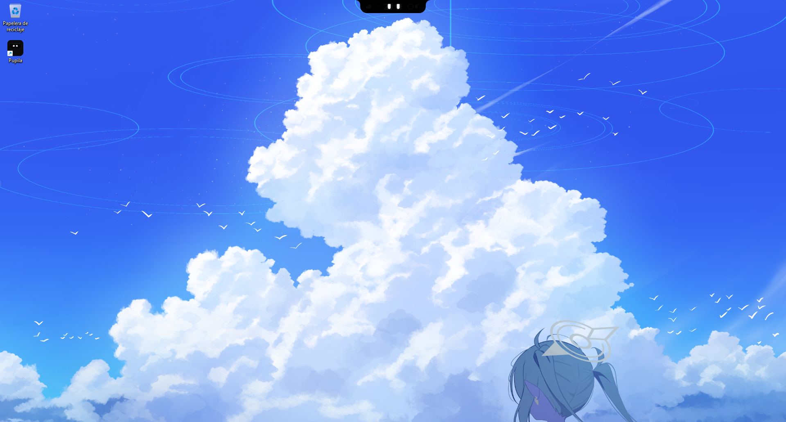
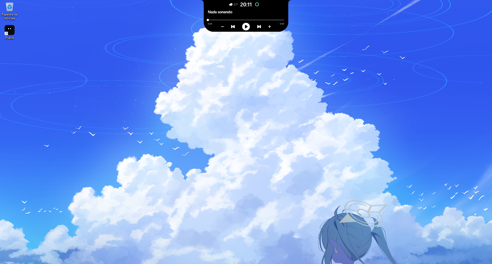

# Pupila

Una isla dinámica para Windows 11. Pasa el mouse por arriba de la pantalla y aparecen la hora, el clima, la música que estás escuchando, tus avisos y una mascota de ojos que se duerme, saluda y mira alrededor.

> **Estado:** 1.0.3-beta, en desarrollo. Solo Windows 11 de 64 bits. Ver [Limitaciones](#limitaciones).

<p align="center">
  
  <br>
  
</p>

## Funciones

- **Reposo:** hora, clima, batería y una mascota de ojos que parpadea, se duerme, saluda y mira alrededor.
- **Saludo de arranque:** una línea de luz recorre el borde superior y aparece "Bienvenido" antes de mostrar el reloj.
- **Reproductor:** muestra la canción que suena, con portada difuminada, barra de progreso, controles y botones de volumen.
- **Espectro:** mientras suena música, la isla muestra barras que siguen el audio.
- **Volumen y brillo:** al cambiarlos aparece una barra compacta dentro de la isla.
- **Mayús y Bloq Num:** al activarlas o desactivarlas, la isla muestra un aviso breve.
- **Avisos:** al llegar un aviso de Windows, la pastilla se ensancha un momento y muestra el nombre de la app y el título del aviso (en un chat, el nombre del contacto). Después vuelve a ser una campanita que cuenta los avisos que no has visto. Nunca muestra el texto del mensaje.
- **Carga:** al conectar o desconectar el cargador, la isla lo muestra con una animación.
- **Modo mínimo:** desde el icono de la bandeja, la isla se queda como una barrita discreta.
- **Animaciones fluidas:** todas van a 60 cuadros por segundo, sin importar la frecuencia del monitor. El consumo de memoria y de CPU todavía se está ajustando.

Está hecha para usuarios de habla hispana: la interfaz y los textos están en español.

## Instalar

1. Descarga `pupila-setup-1.0.3-beta.exe` desde la [página de versiones](https://github.com/Suxxeen/pupila/releases).
2. Ejecútalo. No pide permisos de administrador: se instala en tu carpeta de usuario.
3. Si quieres que arranque con Windows, marca la opción en el instalador.

### La advertencia de Windows

Pupila todavía no está firmada digitalmente. Una firma de código cuesta dinero, y todavía no hay una opción gratuita que funcione para este proyecto. Por eso Windows puede mostrar **"Windows protegió tu PC"**. Para abrirla:

1. Haz clic en **Más información**.
2. Haz clic en **Ejecutar de todas formas**.

Si no quieres confiar en el ejecutable, puedes compilarlo tú mismo con las instrucciones de abajo.

## Privacidad: qué hace Pupila con tus datos

Esta sección describe lo que el programa hace de verdad. Si algo cambia en el código, cambia esta sección también.

**Conexiones a internet.** Pupila solo se conecta a un sitio: `api.open-meteo.com`, para el clima. Le envía la latitud y la longitud, nada más. No hay servidor propio, no hay telemetría y no se envía nada más.

**Multimedia (canción, portada, controles).** Pupila lee de los controles de multimedia de Windows (SMTC) el título, el artista, la portada, si la música está sonando y en qué segundo va. Los botones de la isla le piden a Windows reproducir o pausar, pasar a la siguiente o a la anterior, y cambiar la posición cuando tocas la barra. Funciona con las apps que Windows reconoce; no todas aparecen.

**Volumen.** Pupila lee el volumen del altavoz predeterminado y si está silenciado, unas 8 veces por segundo, y revisa qué altavoz es el predeterminado cada 3 segundos. Los botones `+` y `−` de la isla mandan la misma tecla de volumen que las de tu teclado, para que Windows muestre su propio indicador.

**Brillo.** Windows avisa a Pupila cuando cambia el brillo de la pantalla, mediante un evento de WMI. Como respaldo, revisa el brillo cada 10 segundos. Solo funciona en pantallas que exponen su brillo por WMI, como muchas laptops.

**Teclado.** Pupila instala un gancho de teclado de bajo nivel, que en teoría podría ver todo lo que escribes. Pero el código solo mira tres grupos de teclas: volumen (subir, bajar y silenciar), Mayús y Bloq Num. Las demás teclas se descartan en el momento. Pupila no guarda ni envía lo que escribes. Las teclas que llegan desde un programa (incluidas las que manda Pupila para el volumen) se ignoran, para que no se repitan.

**Audio para el espectro.** Pupila captura lo que suena por el altavoz predeterminado (no el micrófono) y lo analiza en memoria para dibujar las barras. No se guarda ni se envía.

**Clima.** Primero lee el texto del botón de Widgets de la barra de tareas de Windows, por ejemplo "Widgets 29°C Parc. soleado". Si ese botón no está, le pide a Windows la ubicación (Wi-Fi o GPS) con un proceso de PowerShell, y consulta Open-Meteo con esa ubicación. No usa tu dirección IP y no guarda la ubicación. Se actualiza al arrancar y cada 15 minutos.

**Avisos.** Un proceso de PowerShell en segundo plano pide a Windows la lista de avisos. Solo usa el identificador de cada aviso, el nombre de la app que lo mandó y su título (en un chat, el nombre del contacto). No lee el texto del mensaje. Lo que lee solo vive en memoria un momento y no se guarda ni se envía. El proceso se cierra cuando Pupila se cierra.

**Pantalla bajo la isla.** Para esconder la isla cuando hay una pestaña o una página debajo, Pupila lee la estructura de la ventana activa (solo lectura). No cambia nada, no hace clic y no guarda nada.

**Batería.** Consulta el porcentaje y si el equipo está conectado al cargador cada 30 segundos, y también cuando Windows avisa que cambió la corriente.

**Archivos.** Pupila guarda solo dos scripts de PowerShell en `%APPDATA%\Pupila`: `avisos.ps1` y `ubicacion.ps1`. No hay archivos de configuración ni registros.

**Procesos de PowerShell.** Los dos scripts se ejecutan con `-ExecutionPolicy Bypass`, para poder correr su propio archivo sin cambiar la política de Windows.

**Arranque con Windows.** Solo si lo marcas en el instalador. Pupila agrega una entrada en el inicio de tu usuario, y el desinstalador la quita.

## Compilar

Necesitas el [.NET 10 SDK](https://dotnet.microsoft.com/download).

El proyecto está en la carpeta `Pupila` de este repositorio. Entra ahí y compila y prueba con:

```bash
dotnet build -c Release
```

Para generar un solo ejecutable autocontenido:

```bash
dotnet publish -c Release -r win-x64 --self-contained true -p:PublishSingleFile=true -p:IncludeNativeLibrariesForSelfExtract=true -o publish
```

Para crear el instalador, instala [Inno Setup 6](https://jrsoftware.org/isinfo.php), genera primero el ejecutable con el comando anterior y luego compila `Pupila/instalador/pupila.iss`. El instalador queda en `Pupila/release/`.

Más detalles para quien quiera colaborar: [CONTRIBUTING.md](CONTRIBUTING.md) y [Pupila/documentacion/COMO-FUNCIONA.md](Pupila/documentacion/COMO-FUNCIONA.md).

## Limitaciones

- La app no está firmada digitalmente, así que Windows muestra la advertencia de arriba.
- Solo se prueba en Windows 11. No hay soporte para Windows 10 todavía.
- El clima depende del botón de Widgets de la barra de tareas o, si no está, de la ubicación de Windows. Si cambias el idioma de Windows o cambia el texto de ese botón, la lectura puede dejar de funcionar.
- La música, los avisos y el clima dependen de cómo Windows y cada app expongan esa información. No todas las apps aparecen. Pupila no puede abrir el aviso original: solo muestra lo que Windows entrega.
- Las teclas de brillo de algunas laptops no llegan a las aplicaciones, así que la barra de brillo solo aparece cuando el valor cambia por Windows.

## Autoría

Pupila se hizo con ayuda de IA (Claude, de Anthropic) bajo la dirección de su autor, que no es programador. Las decisiones de diseño y de producto son del autor; el código lo escribió y lo revisó el asistente, y se probó en la PC del autor.

## Firma de código

La firma de código de Pupila está solicitada a la [SignPath Foundation](https://signpath.org/), que la ofrece gratis a proyectos de código abierto a través de [SignPath.io](https://about.signpath.io/). Mientras la solicitud no esté aprobada, el instalador no está firmado y Windows mostrará la advertencia de arriba.

**Equipo y roles**

- Autor, revisor y aprobador de firmas: Suxxeen.

Cuando la firma esté aprobada, cada versión firmada se compilará en GitHub Actions desde este repositorio, y el aprobador la revisará antes de firmarla.

**Privacidad**

Pupila guarda sus datos en tu PC y no los envía a nadie. La única excepción es la consulta del clima a Open-Meteo, con tu latitud y longitud. Lo que se lee y lo que se envía está en la sección [Privacidad](#privacidad-qué-hace-pupila-con-tus-datos).

## Licencia

[MIT](LICENSE). Puedes usar, modificar y distribuir el código; solo conserva el aviso de copyright.

## Créditos

- Iconos del clima: [Phosphor Icons](https://phosphoricons.com/), licencia MIT (ver `Pupila/Recursos/iconos/PHOSPHOR-LICENSE.txt`).
- Audio: [NAudio](https://github.com/naudio/NAudio), licencia MIT.
